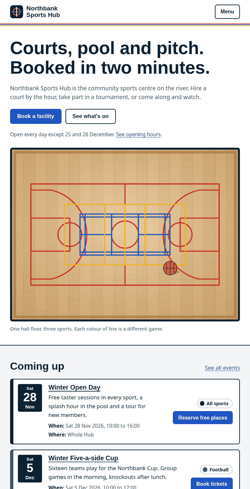

# Northbank Sports Hub: a responsive sports centre website

A complete multi-page website for a fictional community sports centre, written in plain HTML, CSS and JavaScript. It has sports events, booking prices, facilities, a booking form with a live price, about us, contact details, and terms and conditions. There is no framework, no build step, no dependencies and no external requests.

The design idea is a multi-sport hall floor, where each sport's court lines are painted in their own colour. That colour is reused across the site for event tags, event rows and price tables.

<table>
  <tr>
    <td valign="top"></td>
    <td valign="top"></td>
    <td valign="top"></td>
  </tr>
  <tr>
    <td align="center">Desktop</td><td align="center">Tablet</td><td align="center">Phone</td>
  </tr>
</table>

> The centre, people, prices, events, phone number and email address are all made up. The terms and privacy pages are sample text, not legal advice.

## Run it

Open `index.html` in any modern browser. That is all: no server and no internet connection are needed.

## Pages

| File | What it is |
| --- | --- |
| `index.html` | Home: hero, next events, facilities, prices, how booking works, visit us |
| `events.html` | Eight events with a sport filter and a dates-and-prices table |
| `facilities.html` | Pitches, sports hall, tennis, pool, track and function room |
| `pricing.html` | Hire prices (peak and off-peak), memberships, tickets, entry fees, extras |
| `booking.html` | Booking form with a live price and opening-hours checks |
| `confirmation.html` | Booking summary with a reference number |
| `about.html` | Story, timeline, values, numbers, team |
| `contact.html` | Address, opening hours, map, message form, FAQ |
| `terms.html`, `privacy.html` | Sample legal pages |
| `404.html` | Page-not-found page |

## What is inside

- **Responsive at three sizes:** phone (under 640 px), tablet (640 to 991 px) and desktop (992 px and up). The hero image swaps to a different crop on phones with `picture`, tables turn into labelled rows on phones, and the menu collapses into a Menu button.
- **Accessible:** skip link, visible keyboard focus, semantic landmarks, breadcrumbs, descriptive `alt` text, labelled form fields, `aria-current` on the current page, reduced-motion support. Every colour pair used passes WCAG AA contrast (body text is 14.9:1).
- **Creative, correct HTML:** `header`, `nav`, `main`, `section`, `article`, `aside`, `figure`, `time` with `datetime`, `address`, `blockquote`, `mark`, `dl`, `details` and `summary`, tables with `caption` and `th scope`, forms with `fieldset`, `legend`, `output` and date, email, tel and number inputs.
- **A booking form that does the sums:** peak rates apply from 17:00 on weekdays and all weekend, members get 15% off hire, and the form rejects times outside opening hours and the 25 and 26 December closure. The summary page recalculates the price on its own. Nothing is sent anywhere.
- **Works without JavaScript:** every page reads fine without it. Without it, the events filter is hidden and the mobile menu stays open. The booking and summary pages need it, and say so with a phone number.
- **Self-contained images:** all pictures are SVG drawings made for this site, so there are no photos to license.

## Project structure

```text
index.html, events.html, ...      the pages
assets/css/style.css              all styles (colours and fonts are at the top)
assets/js/main.js                 menu, events filter, contact form demo
assets/js/data.js                 prices, events, opening hours (drives the booking form)
assets/js/pricing.js              price rules, shared by booking and summary
assets/js/booking.js              booking form logic
assets/js/confirmation.js         booking summary page
assets/img/                       SVG artwork, logo, favicon and map
tools/check_site.py               checks pages, links, images and form labels
docs/screenshots/                 images used in this README
.github/workflows/                GitHub Pages deploy and site check
```

## Check it

```bash
python3 tools/check_site.py .
```

This checks every page for balanced tags, unique ids, one `h1`, no skipped heading levels, `alt` text on images, labels on form fields, and links, `#anchors` and images that exist. It runs on every push through GitHub Actions. It is a safety net, not a replacement for the official validator at <https://validator.w3.org/>.

## Publish on GitHub Pages

1. In the repository, open **Settings, then Pages**, and set **Source** to **GitHub Actions**.
2. Push to `main`. The `Deploy to GitHub Pages` workflow publishes the pages and `assets` folder only.
3. The site appears at `https://<your-username>.github.io/<repository-name>/`. All links are relative, so it works at that address.

## Make it your own

- **Name and contact details:** search every `.html` file for `Northbank`, `12 Riverside Walk`, `020 7946 0123` and `hello@northbank-hub.example`.
- **Prices:** the figures appear in the tables on `pricing.html` and in `assets/js/data.js`, which drives the booking form's live price. Change both, or the form and the page will disagree.
- **Events:** edit the `article` blocks in `events.html` (and the three on `index.html`), and the matching entries in `assets/js/data.js`.
- **Colours and fonts:** the first lines of `assets/css/style.css`.
- **Images:** replace the SVGs in `assets/img/` with photos if you prefer. Keep the `alt` text and the `width` and `height` attributes.

## Assignment checklist (Week 8, review point 1)

| Criterion | Marks | Where to look |
| --- | --- | --- |
| Pages for the information needs: sports events, booking prices, about us, terms and conditions, etc. | 1 | `events.html`, `pricing.html`, `about.html`, `terms.html`, plus facilities, booking, contact, privacy and 404 |
| Creative use of HTML tags, all pages linked, logical flow, no errors | 1 | See "What is inside". Every page is in the header or footer menu, except the booking summary (reached from the booking form) and the 404 page (shown by the web host). Booking flow: Events or Facilities, then Book, then Summary |
| Nice look and feel, easy to navigate | 1 | One consistent header, footer and breadcrumb trail, colour-coded sports, high contrast, the current page marked in the menu |
| Responsive on at least three screen sizes (images and content) | 2 | Phone, tablet and desktop layouts, shown in the screenshots above. Resize the browser window to see them change |

Before submitting, run each page through <https://validator.w3.org/> (choose "Validate by File Upload") to confirm there are no errors.

## Licence

MIT. See [LICENSE](LICENSE).
