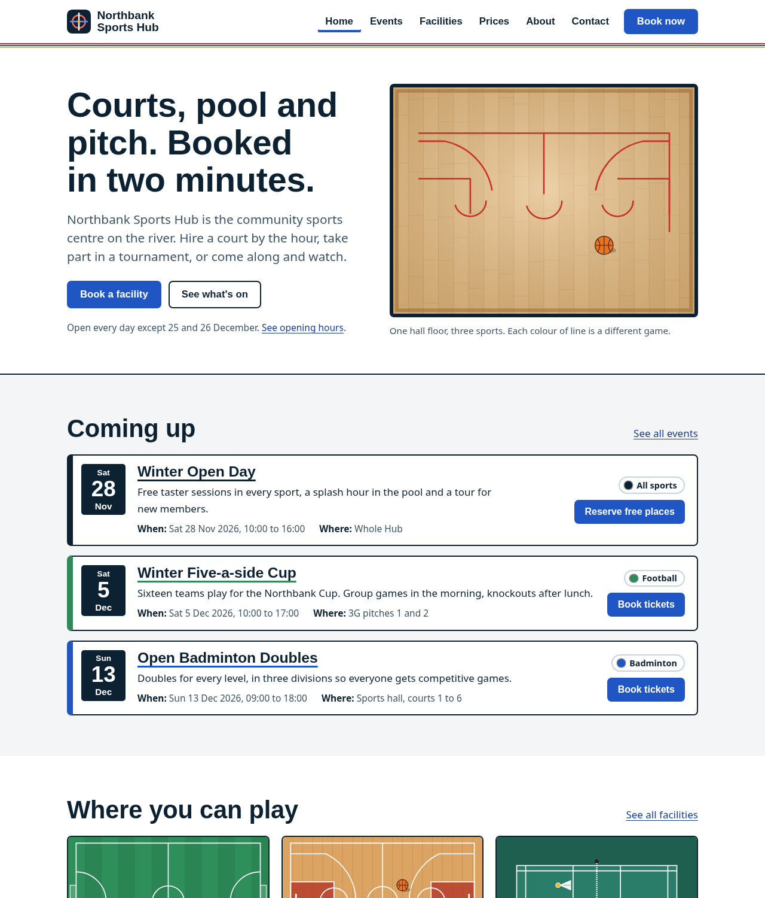
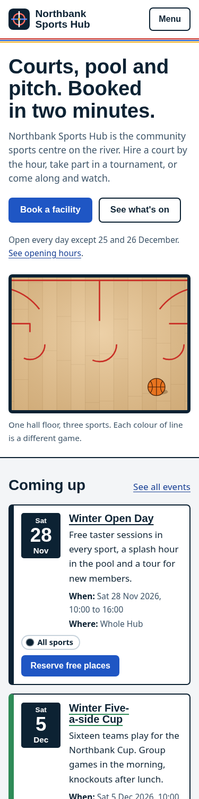
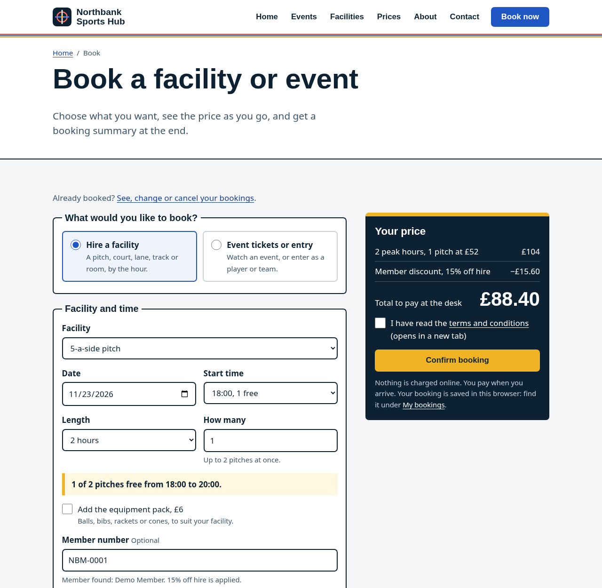
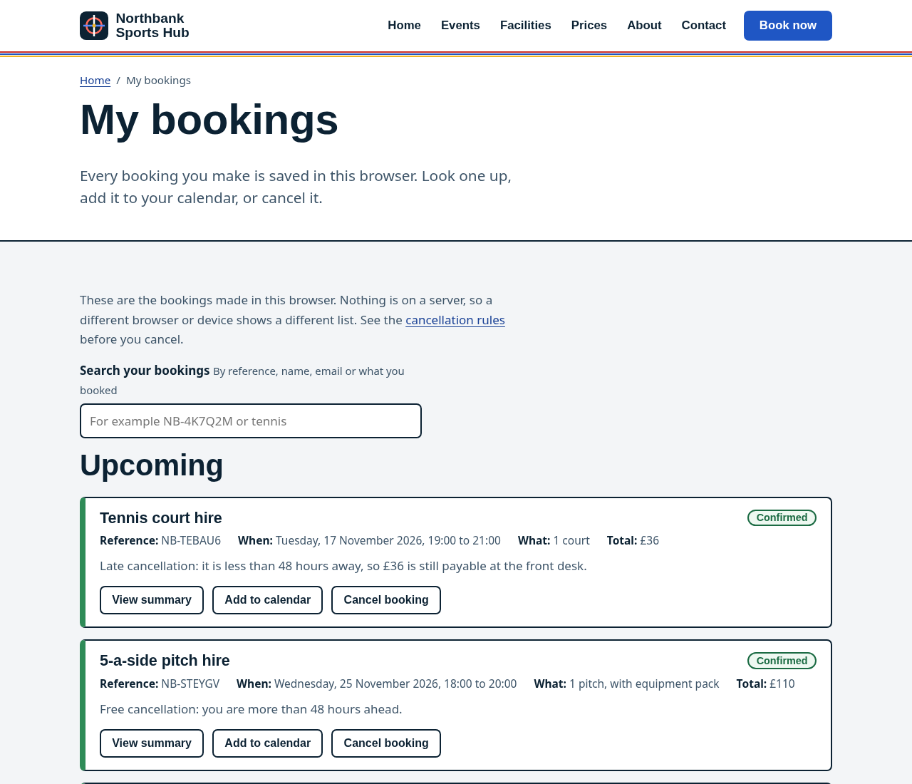
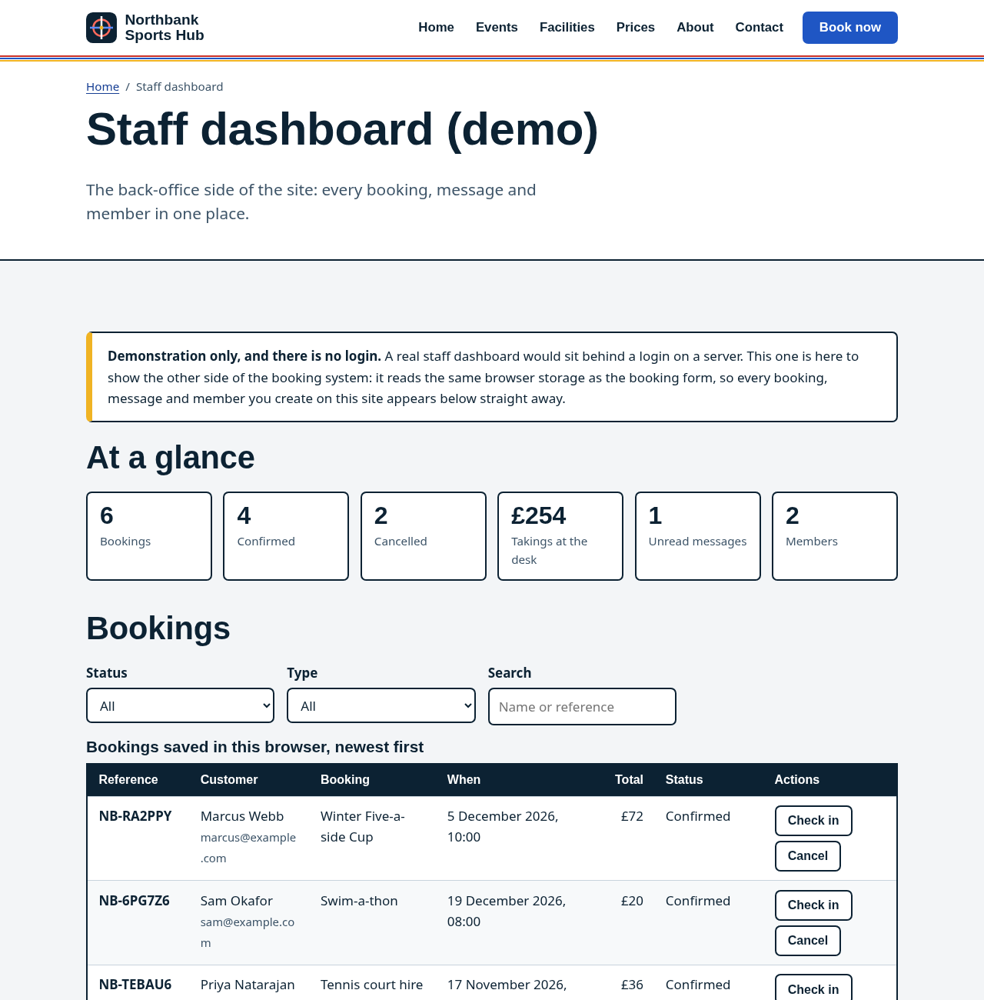

# Northbank Sports Hub: a responsive sports centre website with a working booking system

A complete multi-page website for a fictional community sports centre, written in plain HTML, CSS and JavaScript. Visitors can read about sports events, check prices and facilities, **book a pitch, court, lane or room, buy event tickets, join as a member, cancel a booking and send a message**, and a staff dashboard shows the other side. There is no framework, no build step, no server and no external requests: the "back end" is a small data layer that keeps everything in the visitor's own browser (`localStorage`).

**Source code:** <https://github.com/md8-habibullah/northbank-sports-hub> &nbsp;|&nbsp; **Live website:** <https://md8-habibullah.github.io/northbank-sports-hub/>

The design idea is a multi-sport hall floor, where each sport's court lines are painted in their own colour. That colour is reused across the site for event tags, event rows and price tables.

<table>
  <tr>
    <td valign="top"></td>
    <td valign="top"></td>
    <td valign="top"></td>
  </tr>
  <tr>
    <td align="center">Desktop</td><td align="center">Tablet</td><td align="center">Phone</td>
  </tr>
</table>

> The centre, people, prices, events, phone number and email address are all made up. The terms and privacy pages are sample text, not legal advice.

The booking system, the staff view and the Q&A page (sample data on screen is made up):

<table>
  <tr>
    <td valign="top"></td>
    <td valign="top"></td>
    <td valign="top"></td>
  </tr>
  <tr>
    <td align="center">Book</td><td align="center">My bookings</td><td align="center">Staff dashboard (demo)</td>
  </tr>
</table>

## For markers and teachers: start with the Project Q&A

Open **`qa.html`** (the button in every page's footer). It has 89 questions and answers in 11 topics, a search box, a two-minute "try it yourself" tour, and a table that shows where each marking point is met. Each question has its own link, such as `qa.html#price-calc`.

## Run it

- **Easiest:** open the live site, <https://md8-habibullah.github.io/northbank-sports-hub/>.
- **From a folder:** open `index.html` in any modern browser. All pages read fine. Chrome, Edge and Brave also keep bookings between pages. **Firefox may keep each local file's saved data apart**, so a booking made on one page might not be found on the next. If so, run a tiny server in this folder and open <http://localhost:8000>:

```bash
python3 -m http.server 8000
```

## Try the booking system (two minutes)

1. **Book a pitch** on `booking.html`: pick a date and a time, watch the free places and the price change, tick the terms and press **Confirm booking**. You get a reference such as `NB-4K7Q2M`.
2. Open **My bookings**. It is listed. Press **Cancel booking**: the page tells you whether it is free or a late fee.
3. Book again with the demo member number **`NBM-0001`**: 15% comes off hire. You can also create your own number with **Join online** on `pricing.html`.
4. On `events.html`, see the places left. The Club Tennis Championships entries are full, the Winter Cup has two teams left.
5. **Send a message** on `contact.html`, then open the **Staff dashboard** (`staff.html`) to see your booking, the message and the member.
6. **Reset demo data** (under Demo tools) puts everything back.

## Pages

| File | What it is |
| --- | --- |
| `index.html` | Home: hero, next events, facilities, prices, how booking works, visit us |
| `events.html` | Eight events with a sport filter, live "places left" and a Book button |
| `facilities.html` | Pitches, sports hall, tennis, pool, track and function room |
| `pricing.html` | Hire prices (peak and off-peak), memberships with an online join form, tickets, entry fees, extras |
| `booking.html` | Booking form: live price, live availability, member number check, event capacity |
| `confirmation.html` | The saved booking, found by its reference. Add to calendar, print |
| `my-bookings.html` | Lists, searches and cancels the bookings saved in this browser |
| `staff.html` | Demo back office: bookings, event capacity, messages, members, CSV export |
| `qa.html` | Project questions and answers |
| `about.html` | Story, timeline, values, numbers, team |
| `contact.html` | Address, opening hours, map, message form (saved for the dashboard), FAQ |
| `terms.html`, `privacy.html` | Sample legal pages the booking rules point to |
| `404.html` | Page-not-found page |

## How the booking system works without a server

| Part | What it does | File |
| --- | --- | --- |
| Data layer | Saves bookings, members and messages as JSON in `localStorage` (keys start with `nb:`). Falls back to memory, with a warning, if the browser blocks storage | `assets/js/store.js` |
| Availability | Free pitches, courts and lanes per hour: your real bookings plus a fixed formula that simulates other customers. The sports hall is shared, so basketball and badminton block each other. Event spectator and entry places, with some already sold | `assets/js/availability.js` |
| Price rules | Peak (weekdays from 17:00 and all weekend) and off-peak hours, member discount, equipment pack, tickets and entry fees. Opening hours and closed days | `assets/js/pricing.js` |
| Booking form | Validates, shows the live price, checks member numbers, saves the booking and opens its summary (`confirmation.html?ref=NB-XXXXXX`) | `assets/js/booking.js` |
| Cancellation | Hire needs 48 hours' notice and events 7 days, as in the terms. Later than that, the full price is still due. A cancelled booking frees its places | `assets/js/pricing.js`, `my-bookings.js` |
| Members | Join online gives a number such as `NBM-1001`. The booking form looks numbers up. `NBM-0001` is a built-in demo member | `assets/js/membership.js` |
| Calendar | Builds an `.ics` file in the browser | `assets/js/calendar.js` |
| Staff view | Lists everything, with filters, check-in, staff cancel, messages and a CSV export that defuses spreadsheet formulas | `assets/js/staff.js` |

### What is real and what is simulated

- Real in the browser: saving, finding, updating and cancelling bookings, member numbers, event capacity, the price sums, the checks, the calendar file and the CSV export.
- **Not real:** there is no server, so data lives in one browser and is not shared between devices or people. Other customers' bookings are simulated by a formula. No payment is taken and no email is sent. The staff dashboard has no login. Anything a visitor changes in their own browser only changes their own copy.
- To make it a real site, replace `store.js` with calls to a server API and move the price and availability checks to the server. The Project Q&A explains how.

## What is inside

- **Responsive at three sizes:** phone (under 640 px), tablet (640 to 991 px) and desktop (992 px and up). The hero image swaps to a different crop on phones with `picture`, tables turn into labelled rows on phones, and the menu collapses into a Menu button.
- **Accessible:** skip link, visible keyboard focus, semantic landmarks, breadcrumbs, descriptive `alt` text, labelled form fields, `aria-current` on the current page, a live region for availability, reduced-motion support. Every colour pair used passes WCAG AA contrast (checked with a script).
- **Creative, correct HTML:** `header`, `nav`, `main`, `section`, `article`, `aside`, `figure`, `picture`, `time` with `datetime`, `address`, `blockquote`, `mark`, `dl`, `details` and `summary`, tables with `caption` and `th scope`, forms with `fieldset`, `legend`, `output` and date, email, tel, number and search inputs.
- **Safe by construction:** text typed by visitors is only ever put on a page as text (never as HTML), there are no third-party scripts, no cookies and no trackers.
- **Works without JavaScript where it can:** every information page reads fine without it, and the Q&A boxes open natively. The booking pages need JavaScript and say so, with a phone number.
- **Self-contained images:** all pictures are SVG drawings made for this site, so there are no photos to license.

## Project structure

```text
index.html, events.html, ...      the pages
assets/css/style.css              all styles (colours and fonts are at the top)
assets/js/data.js                 prices, events, capacities, opening hours (read by every script)
assets/js/pricing.js              price, opening-hours and cancellation rules
assets/js/store.js                the browser data layer (localStorage)
assets/js/availability.js         what is free, and event places
assets/js/booking.js              booking form
assets/js/confirmation.js         booking summary page
assets/js/my-bookings.js          list, search and cancel
assets/js/staff.js                demo staff dashboard
assets/js/calendar.js             .ics calendar file
assets/js/membership.js           join online
assets/js/contact.js              contact form
assets/js/places.js               "places left" on the events page
assets/js/qa.js                   search on the Project Q&A page
assets/js/main.js                 menu, events filter, footer year
assets/img/                       SVG artwork, logo, favicon and map
tools/check_site.py               checks pages, links, images and form labels
tools/test_logic.js               tests for prices, saved data, availability, cancellation, calendar
docs/screenshots/                 images used in this README
.github/workflows/                GitHub Pages deploy and checks
```

## Check it

```bash
python3 tools/check_site.py .     # pages, links, images, labels
node tools/test_logic.js          # price rules, store, availability, cancellation, calendar
```

`check_site.py` checks every page for balanced tags, unique ids, one `h1`, no skipped heading levels, `alt` text on images, labels on form fields, and links, `#anchors` and images that exist. `test_logic.js` loads the real scripts into a fake browser with a fixed date and checks the rules, and it also fails if a price on `pricing.html` differs from `assets/js/data.js`. Both run on every push through GitHub Actions. They are a safety net, not a replacement for the official validator at <https://validator.w3.org/>.

## Publish on GitHub Pages

1. In the repository, open **Settings, then Pages**, and set **Source** to **GitHub Actions**.
2. Push to `main`. The `Deploy to GitHub Pages` workflow publishes the pages and `assets` folder only.
3. The site appears at `https://<your-username>.github.io/<repository-name>/`. All links are relative, so it works at that address.

## Make it your own

- **Name and contact details:** search every `.html` file for `Northbank`, `12 Riverside Walk`, `020 7946 0123` and `hello@northbank-hub.example`.
- **Prices:** the figures appear in the tables on `pricing.html` and in `assets/js/data.js`, which drives the booking form. Change both: `node tools/test_logic.js` fails if they disagree.
- **Events:** edit the `article` blocks in `events.html` (and the three on `index.html`), and the matching entries, times and capacities in `assets/js/data.js`.
- **Colours and fonts:** the first lines of `assets/css/style.css`.
- **Images:** replace the SVGs in `assets/img/` with photos if you prefer. Keep the `alt` text and the `width` and `height` attributes.

## Assignment checklist (Week 8, review point 1)

| Criterion | Marks | Where to look |
| --- | --- | --- |
| Pages for the information needs: sports events, booking prices, about us, terms and conditions, etc. | 1 | `events.html`, `pricing.html`, `about.html`, `terms.html`, plus facilities, booking, my bookings, contact, privacy, the Q&A and 404 |
| Creative use of HTML tags, all pages linked, logical flow, no errors | 1 | See "What is inside". Every page is in the header or footer, except the booking summary (reached from the booking form and My bookings) and the 404 page (shown by the web host). Booking flow: Events or Facilities, then Book, then Summary, then My bookings |
| Nice look and feel, easy to navigate | 1 | One consistent header, footer and breadcrumb trail, colour-coded sports, high contrast, the current page marked in the menu |
| Responsive on at least three screen sizes (images and content) | 2 | Phone, tablet and desktop layouts, shown in the screenshots above. Resize the browser window to see them change |

Before submitting, run each page through <https://validator.w3.org/> (choose "Validate by File Upload") to confirm there are no errors.

## Licence

MIT. See [LICENSE](LICENSE).
